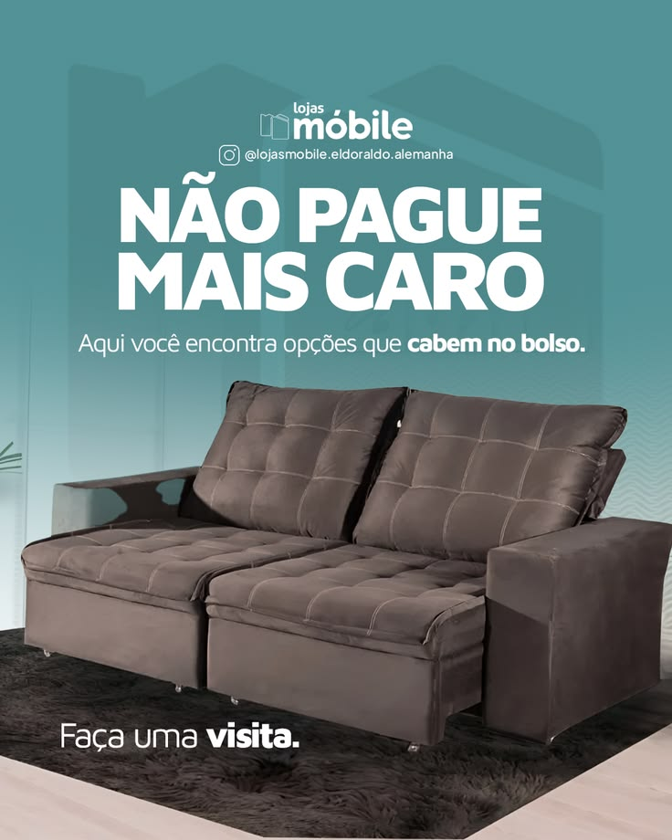
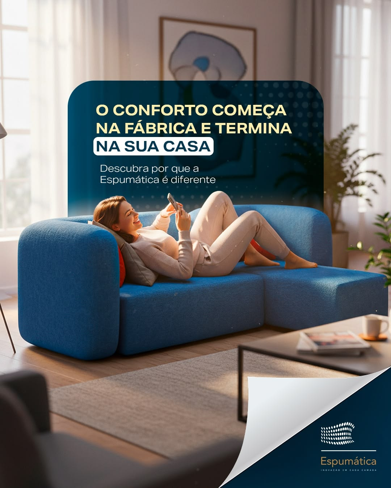
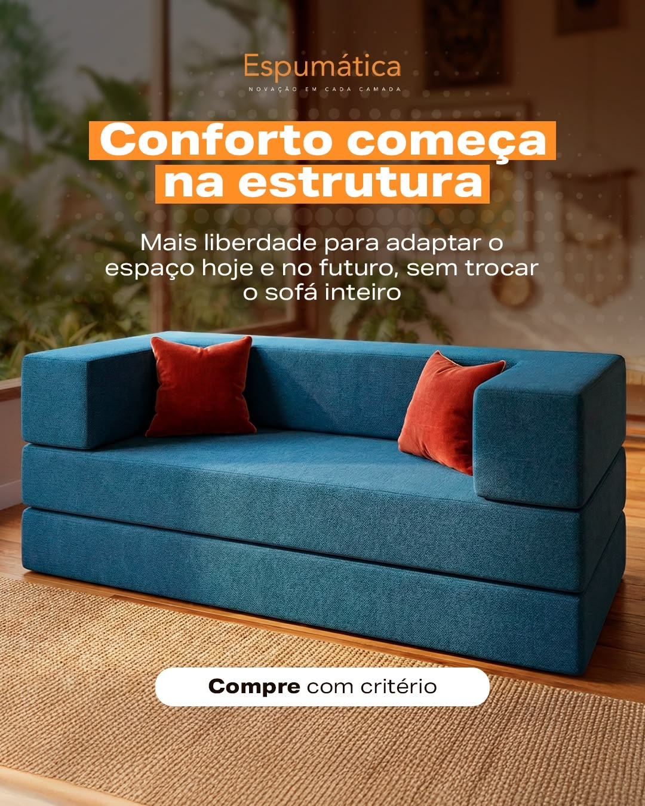

# Referências visuais e de copy — vitrine de produto e institucional simplificado

**Recebido de:** PH, 2026-10-06 · **Cliente:** veneza-estofados
**Uso:** base dos formatos registrados em [PADROES §13 e §14](../PADROES.md).

> Referências de **layout e estrutura de copy**, não de imagem. Duas das três usam render/imagem com cara de IA, e a Veneza trabalha com foto real do banco do cliente ([PADROES §3](../PADROES.md)). Nenhuma das três marcas é concorrente direta na Região dos Lagos, mas a copy delas **não se copia literal**.

---

## Ref. 3 — Lojas Móbile · "Não pague mais caro" → formato **vitrine de produto sem preço**

**O que tem:** fundo de cor única com uma marca-d'água discreta (contorno de casa) · logo + @ no topo, centralizados · headline gigante em sans condensada bold, caixa alta, duas linhas · subtítulo de uma linha com a palavra-chave em negrito · produto em **PNG recortado** ocupando o centro, grande · CTA curto no rodapé ("Faça uma visita.") com a palavra de ação em negrito · **sem preço**.

**Proposta de PH:** usar a estrutura pra um formato novo de apresentação de produto, com **nome + especificação**, **sem preço**, headline e copy que deem valor. Exemplo dele:

> **Headline:** O conforto que você precisa com a elegância que você quer
> **Produto:** Sofá Athena 2,70m
> **Copy:** Venha conferir de perto nosso campeão de vendas

**O que pegar:** hierarquia de três níveis (headline → produto → CTA), produto grande, logo no topo, CTA de visita.
**O que não pegar:** "não pague mais caro" (gancho de preço sem mostrar preço, e a Veneza não entra em disputa de preço com concorrente, [context §Voice](../context.md)) · fundo chapado sem nada (vira template genérico).

## Ref. 1 — Espumática · "O conforto começa na fábrica e termina na sua casa" → **institucional simplificado**

**O que tem:** foto de ambiente com sofá e pessoa · painel translúcido azul-marinho com cantos arredondados · headline em caixa alta, três linhas, com a frase final destacada numa **pílula branca** · subtítulo de uma linha · logo no canto, com efeito de página virando.

**O que pegar:** mensagem institucional numa frase só, de origem → resultado; destaque de **uma** expressão da headline; painel que separa o texto da foto sem cobrir o produto.
**O que não pegar:** a foto (pessoa e sala com cara de render de IA) · "termina na sua casa" (puxa o assunto entrega, o ponto fraco da reputação da Veneza, [PADROES §8](../PADROES.md)) · "Descubra por que…" (CTA vago) · efeito de página virando, que vira elemento órfão se não for repetido ([PADROES §7](../PADROES.md)).

## Ref. 2 — Espumática · "Conforto começa na estrutura" → **institucional simplificado**

**O que tem:** produto grande sobre ambiente desfocado · headline curta, duas linhas, em **caixas de cor** atrás de cada linha · subtítulo de benefício em duas ou três linhas · CTA em pílula branca no rodapé ("Compre com critério") · logo no topo.

**O que pegar:** headline curtíssima sobre o que está **dentro** do produto (estrutura), caixa de cor atrás do texto, pílula de CTA no rodapé.
**O que não pegar:** laranja (fora da paleta) · "Compre com critério" (CTA vago) · a frase "conforto começa na estrutura" literal, que é deles.
